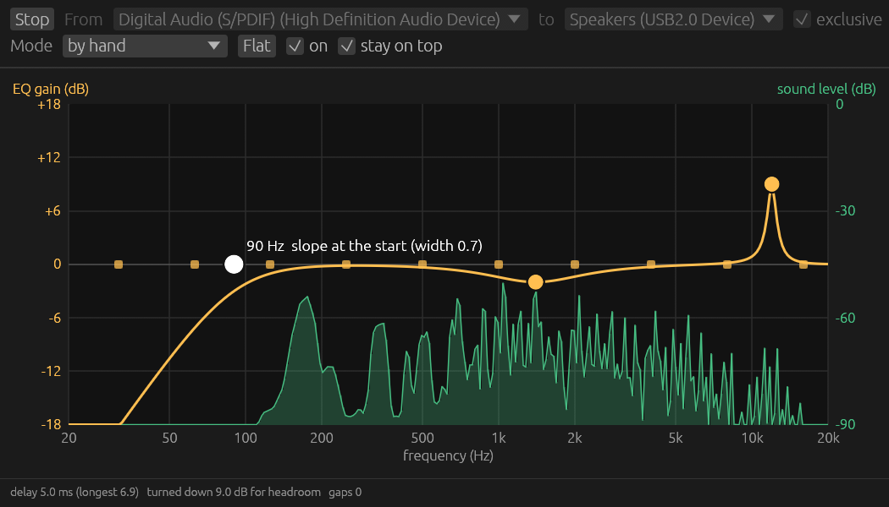

# Bottle EQ

A system-wide audio equalizer for Windows and Linux with a live visualizer, in Rust. Built in five steps; all five
are made, and nobody has yet sat with it and listened.

1. **Audio capture** (done): what Windows plays is captured by WASAPI loopback and played back out,
   5.8 ms later.
2. **EQ engine** (done): ten bands, 20 modes, and points as in FL Studio's parametric EQ.
3. **"Flat" button** (done), with a hook for per-device correction curves (`modes.txt`).
4. **Visualizer** (done): an always-on-top window with the live spectrum and the EQ curve on one graph.
5. **Draggable curve** (done): the bands and the points are dragged with the mouse.

## The window



`bottle-eq` (or `bottle-eq window --from "S/PDIF" --to "Speakers"`) opens it (`src/window.rs`). It stays
on top of other windows. Choose where the sound is captured from and where it is played, and press Start.

One graph, from 20 Hz to 20 kHz on a logarithmic axis:

- **green: the live spectrum** of the sound the target is being given (so after the equalizer), its
  level in dB on the right-hand scale. 8192 samples at a time (171 ms, bins 5.9 Hz apart), Hann window;
  a level rises at once and falls 30 dB a second (`src/spectrum.rs`). What is drawn is the level of the
  sixth of an octave around each frequency (the bins' power there added up), so it is one smooth line:
  level for sound with as much power in every octave, as most music roughly has, and bent where the
  equalizer raises or lowers it;
- **amber: the equalizer's curve**, its gain in dB on the left-hand scale, with its handles:
  - the **small squares** are the ten bands: drag one up or down for that band's gain;
  - the **round points** are the free ones, as in FL Studio: drag one sideways for its frequency and up
    or down for its gain. The wheel over a point is its width. The right button on a point is its kind
    (a slope at the start or the end, a shelf, a peak, a spike) or takes it away; the right button or a
    double click on the empty graph makes a new point there (eight at most).

The sound changes while a handle is dragged: every move goes to the audio thread at once, which slides
to it without a click. **Mode** sets the ten bands; **Flat** puts every band at 0 dB and the points back
where they began (three of them at 0 dB): the sound then passes bit for bit as it came. **on** unticked
lets the sound pass untouched whatever is set, to hear the difference. The line at the bottom is the
delay, how far the sound is turned down for headroom, and the gaps so far.

Crates: `windows` (the audio), `rustfft` (the spectrum), `eframe`/egui (the window).

Checked:

- `cargo test`: the graph's places and frequencies agree both ways; the pointer takes the nearest handle
  within reach, a point before a band it lies on; a point dragged to 10 kHz and +8 dB is there and the
  curve is raised there; a slope follows the pointer only sideways; a sine stands in the spectrum at its
  frequency and level and falls 30 dB a second after it ends.
- In the running window (the picture above): Bach played to S/PDIF, a slope at 90 Hz, a dip, and a
  spike at 11 kHz that the window's own test (`--drag 3:12k:+9`: press, twelve moves, release, given to
  egui as pointer events) dragged to 12 kHz and +9 dB while the music played; the spectrum shows the
  slope and the spike in the sound. Delay 5.0 ms on average, 6.9 ms at the longest, no gap.

Not done: no hand has dragged it yet and nobody has listened. The devices chosen are not remembered
from one opening to the next. Run by double click, a console window opens beside it.

## The equalizer

Two layers make the curve (`src/eq.rs`), both run in the audio thread on each block just before it is
handed to the target:

- **Ten bands** at the octave centres 31.5, 63, 125, 250, 500, 1k, 2k, 4k, 8k and 16k Hz: the lowest a
  low shelf, the highest a high shelf, the eight between peaks one octave wide, each from -12 to +12 dB.
- **Points, as in FL Studio's parametric EQ**: up to eight filters put anywhere, each with a frequency, a
  gain, a width and a kind:
  - a **cut** makes the curve start (or end) with a slope: 12 dB an octave below a low cut. Its width is
    how sharp the corner is; a sharp one stands up as a ridge before the slope;
  - a **shelf** raises or lowers everything below (or above) the point;
  - a **peak** is a bump or a dip around the point; narrow, it is a spike.
  A point given no kind is a shelf if it is the lowest or the highest of several, else a peak.

They are RBJ's biquads in the shape of Vuuvee's `dsp/biquad.rs` (direct form I, 64-bit), one after
another.

- **Flat is exact.** A band or point at 0 dB is skipped, so with everything at 0 the sound leaves bit
  for bit as it came.
- **No clicks when the curve is set.** It is set from another thread through a few atomics; the audio
  thread moves each gain 0.25 dB and each frequency 6% a block (about 3 ms) toward what is set.
- **No clipping.** The whole sound is turned down by the highest point of the curve (headroom), so a
  raised curve cannot push a full-scale sound over. Raising part of it therefore makes the rest quieter.

### Modes

A mode is a named set of the ten bands' gains. There are 20 in `modes.txt`: Flat, Bass Boost, Deep
Bass, Bass Reducer, Treble Boost, Treble Reducer, Loudness, Classical, Rock, Pop, Jazz, Electronic,
Hip-Hop, Acoustic, Vocal, Speech, Movie, Gaming, Night, Small Speakers. They are starting shapes, not
measured for any speaker and not taken from any other program; the file is meant to be edited, and a
`modes.txt` in the folder Bottle EQ is run from is read instead of the one built in. A correction curve
for one pair of speakers is a line there like any other (the hook of step 3).

A mode sets the bands; the points stay as they are, on top of it. `flat` sets every band and point to
0 dB and takes the cuts away.

```
bottle-eq modes
bottle-eq run --from "S/PDIF" --to "Speakers" --mode rock
bottle-eq run --from "S/PDIF" --to "Speakers" --points "100:cut 1k:-2 12k:+8:spike"
bottle-eq curve --mode "bass boost" --points "100:cut:1.5 12k:+8:spike"      # the curve they make
bottle-eq run ... --gains 4,2,0,0,0,0,0,0,2,4                                # the ten bands by hand
```

A point is written `frequency:dB`, then optionally its width and its kind: `80:+5`, `1k:-3:2` (narrower),
`100:cut` (a slope at the start), `100:cut:1.5` (with a ridge), `12k:+8:spike`, `8k:+4:shelf`. Kinds:
`cut`, `shelf` (low or high by which side of 1 kHz), `lowcut`, `highcut`, `lowshelf`, `highshelf`, `peak`,
`spike`.

While `run` plays, a line sets the curve: `mode rock`, `modes`, `points 100:cut 12k:+8:spike`, `1k +3`
(one band), `flat`, `off`, `on`; an empty line stops. In the window of steps 4 and 5 the points are what
is dragged.

Measured:

- `cargo test`: 11 tests. Flat leaves the sound as it came (also with points standing at 0 dB); a band's
  peak is its gain at its centre, half of it half an octave away and nothing far away; the shelves raise
  the ends; points are shelves at the ends and peaks between, in whatever order they are given; a cut is
  -3 dB at its corner and 12 dB an octave below, a sharp one a ridge, a narrow peak a spike; a sine
  through bands and points together comes out at what the curve says within 0.05 dB at eleven
  frequencies; everything at +12 or -12 stays sound; the headroom keeps a full-scale sine at full scale;
  bands and points set, dragged and taken away while playing do not click; the 20 modes read and are
  found by name; flat takes the cuts away and keeps the points where they are.
- In the running path (`tools/eqcheck.py`: 20 s of pink noise played to S/PDIF, the spectrum of what the
  speakers were given over the spectrum of what was captured, against the curve, at 108 points from
  30 Hz to 18 kHz):

  | curve | mean difference | biggest |
  |---|---|---|
  | `--gains 6,0,-4,0,3,-6,0,4,0,-3` | 0.01 dB | 0.05 dB at 101 Hz |
  | `--mode "bass boost" --points "100:cut:1.5 1k:-2 12k:+8:spike"` | 0.03 dB | 0.37 dB at 11.5 kHz |

  (The 0.37 dB is on the flank of the narrow spike, where the measuring band, a twelfth of an octave, is
  wide against the curve's bend.) No gap, delay 5.9 ms on average and 8.1 ms at the longest.

Not done: nobody has heard it.

## On Linux

The equalizer, the modes, the spectrum and the window are the same code on both systems; only the
sound's way in and out differs (`src/audio.rs`: `audio/wasapi.rs` on Windows, `audio/pipewire.rs` on
Linux, which needs PipeWire, as current distributions have).

PipeWire is one graph in which every program that plays and every device is a node, all run in the same
cycle. So nothing is listened to from the side as on Windows: Bottle EQ puts **a device of its own,
"Bottle EQ"**, into the graph and plays what arrives there, equalized, on to the speakers within the
same cycle. There is no spare device to go round by, no second clock, no cushion and no exclusive mode.

```
sudo apt install libpipewire-0.3-dev libclang-dev pkg-config     # to build (Ubuntu's names)
cargo build --release
bottle-eq devices                 # 1 is Bottle EQ's own device, the others are the speakers
bottle-eq window --to <speakers>  # starts at once; then choose "Bottle EQ" as the output device in the sound settings
bottle-eq run --to <speakers> --mode rock
```

Checked (2026-11-21) in a box without a sound card (`linux/Dockerfile`, `linux/test.sh`: Ubuntu 24.04,
PipeWire 1.0.5 and WirePlumber, one output device that plays to nowhere):

- `cargo test`: 17 tests (the 15 of Windows and two of the PipeWire part).
- `selftest`: the 1 kHz tone comes through whole (100% of the sound is 1 kHz, no jump beyond the tone's
  own, nothing dropped, never dry).
- Flat: 20 s of pink noise leave **bit for bit** as they came (1,034,496 frames compared).
- The equalizer in the running path, as on Windows (`tools/eqcheck.py`, same noise, same curves):

  | curve | mean difference | biggest |
  |---|---|---|
  | `--gains 6,0,-4,0,3,-6,0,4,0,-3` | 0.01 dB | 0.05 dB at 101 Hz |
  | `--mode "bass boost" --points "100:cut:1.5 1k:-2 12k:+8:spike"` | 0.03 dB | 0.37 dB at 11.5 kHz |

- The window (under Xvfb, software OpenGL): it opens, shows the live spectrum of music played to
  "Bottle EQ", and its own test drags a point (`docs/window-linux.png`).

Not done on Linux: it has never run on a real machine with a sound card and a desktop, so nobody has
heard it, the delay is not measured (the box's device says 0 ms; what is shown is what PipeWire says of
the way to the device, as for any program), and programs that speak PulseAudio (browsers; through
pipewire-pulse) have not been tried, only PipeWire's own.

## How the sound gets through (WASAPI loopback)

Windows mixes every program's sound for one output device (an endpoint: the speakers, S/PDIF) into one
stream, one block ("period") at a time: 10 ms unless someone asks for less. Loopback is a capture
stream opened on an *output* endpoint: Windows hands over a copy of the finished mix on its way to that
device. Five things follow:

1. **It is a copy.** The device still plays the original, so Bottle EQ captures from one endpoint, the
   **source** (the one Windows plays to, which you do not hear), and plays the processed sound to
   another, the **target** (the one you listen to). On this machine the source is S/PDIF (nothing is
   plugged into it) and the target is the USB speakers.
2. **Silence is no data.** When nothing plays, loopback delivers nothing; playback then plays silence.
3. **Two devices, two clocks.** Their 48,000 Hz differ by some tens of parts per million. The ring
   between capture and playback is read a hair fast or slow (at most 0.1%, under 2 cents of pitch) so
   that its fill stays at the cushion, and the lasting difference is learned.
4. **The delay is made of blocks.** A sound waits for the source's block to end, then in the ring, then
   for the target's buffer. With 10 ms blocks on both sides that was 44 ms. So the source's engine is
   asked for its least block (IAudioClient3: 2.67 ms on S/PDIF; a silent stream at that period is
   enough), and the target is opened in **exclusive mode** at its least block (3 ms): Bottle EQ then
   owns the speakers and nothing else can play to them while it runs. `run` asks before taking them
   (`--exclusive` and `--shared` answer in advance).
5. **Exclusive mode cannot be listened to by loopback**, so the delay is measured on the clock: from a
   block arriving from the source's engine to its frames beginning to play at the target.

In exclusive mode the path is one thread (`direct` in `src/wasapi.rs`): wait for a block from the
source, read it at the target's rate, process it, write it into the target's buffer. In shared mode it
is capture thread -> lock-free ring -> playback thread. The audio threads have Windows' "Pro Audio"
priority, wake on the device's own event, and never lock or allocate. All of it is on WASAPI directly,
through the `windows` crate.

## Use

```
bottle-eq                                          the window (on Linux: bottle-eq window --to <speakers>)
bottle-eq devices                                  the output devices, their formats and blocks
bottle-eq run --from <device> --to <device>        capture what plays to one, play it to the other (Enter stops)
bottle-eq selftest --from <device> --to <device>   a quiet 1 kHz tone through the whole path, measured
```

A device is its number in `devices` or a part of its name. `--cushion-ms <n>` is the sound kept in the
target's buffer on top of what the two devices' blocks need (default 2). To use it: make the source the Windows
default output device, then `run`.

## Measured (2026-11-20, this machine)

`selftest` plays a 1 kHz tone at -40 dB to S/PDIF like any program would, and looks at what is captured
and at what is handed to the target: how much of it is the tone, the loudest jump between two frames (a
click shows there), whether the device ran out of sound, and the delay Bottle EQ adds (from a block
arriving from the source's engine to its beginning to play).

To the USB speakers, exclusive mode, 16-bit, periods of 144 frames (3 ms):

| path | cushion | tone | delay, mean | longest | ran out | clean |
|---|---|---|---|---|---|---|
| cpal, shared mode (the first version) | 25 ms | 1.5 s | 44 ms | | 0 | yes |
| two threads and a ring | 3 ms | 20 s | 11.9 ms | 17.6 ms | 0 | yes |
| two threads and a ring | 1 ms | 60 s | 8.2 ms | 15.7 ms | 16 | no: clicks |
| **direct** | 3 ms | 5 s | 9.1 ms | 11.4 ms | 0 | yes |
| **direct** | 2 ms (default) | 30 s | 6.0 ms | 12.7 ms | 0 | yes |
| **direct** | 1 ms | 30 s | 4.8 ms | 9.7 ms | 0 | yes |
| **direct** | 1 ms | 60 s | 4.6 ms | 9.9 ms | 0 | yes |
| **direct** | 1 ms | 20 s, three runs | | | 0 | yes |

The direct path (the default in exclusive mode): one thread; each block is read at the target's rate,
processed and written into the target's buffer as it arrives from the source, behind what is already
queued. With two threads the ring had to hold a whole block of the target's before every read, because
the two threads woke on two unrelated clocks; that block is what was saved. The longest delays are from
the first seconds, while the two clocks' difference is still being learned. Shared mode still goes
through the ring and two threads.

Not explained: in 2 runs of 10 the *captured* sound itself had one jump (0.00792 both times, where the
tone alone moves 0.0013 a frame), with no break reported by Windows; the path passed it on as it came.
It is either this test's tone or the source's engine at its short period. `selftest` says so when it
sees it.

### With music

`playtest` plays a WAV file to the source and keeps what was captured and what the target was given:

```
bottle-eq playtest --from "S/PDIF" --to "Speakers" --exclusive --file test/music.wav --level 0.1 --record test/out
python tools/compare.py test/music.wav test/out/captured.wav 0.1    # wave against wave
python tools/spectra.py test/out/captured.wav test/out/handed.wav   # band against band
```

40 s of Bach's Toccata and Fugue in D minor, BWV 565 (a public-domain recording from Wikimedia Commons,
`Toccata_et_Fugue_BWV565.ogg`, performed by Ashtar Moïra), played 20 dB down:

- No gap anywhere: ran out 0 times, 0 dropped, 0 late, 0 breaks. Delay 5.3 ms on average after the first
  3 s, 10.4 ms at the longest (the queue at its fullest and a whole period's wait at once).
- **Played -> captured** (the source side): the same sound, wave for wave (alike 1.00000 in every 43 ms
  window but the first, where the comparison had not yet found its place), 0.78 dB lower: the S/PDIF
  device's own volume setting, most likely.
- **Captured -> given to the speakers** (Bottle EQ itself, with nothing switched on: there is no
  equalizer yet, so flat is what it should be), level by octave band over the whole piece:

  | band (Hz) | 31.5 | 63 | 125 | 250 | 500 | 1k | 2k | 4k | 8k | 16k |
  |---|---|---|---|---|---|---|---|---|---|---|
  | 4-point read (first) | 0.00 | 0.00 | 0.00 | 0.00 | 0.00 | 0.00 | 0.00 | -0.01 | -0.12 | -0.78 |
  | windowed sinc (now) | 0.00 | 0.00 | 0.00 | 0.00 | 0.00 | 0.00 | 0.00 | 0.00 | 0.00 | +0.01 |

  And through the piece, in stretches of 5 s: the 16 kHz band was -0.68 to -0.90 dB with the 4-point
  read (and from one 85 ms window to the next anything from +0.06 to -2.06 dB, as the two clocks slid
  past each other); with the sinc it is 0.00 to +0.03 dB in every stretch. Window by window (937) the
  biggest difference in any band is 0.04 dB in the median (was 0.53), 1 window differs by more than
  3 dB (at 0.73 s, where the two files are least well lined up), none by 6 dB: no click or gap shows.
- The sinc reads 16 frames behind the newest sound (0.33 ms), which is counted in the delay: 5.8 ms on
  average, 9.9 ms at the longest, for this piece.
- The one window that differed by more than 3 dB (0.725 to 0.811 s) holds the very first note of the
  piece (0.788 s). Lined up on its own it differs by 0.00 to 0.01 dB in every band: it was 163 frames
  off the place the whole file was lined up to, because the delay was 3.4 ms longer at the start than
  later (the device takes a few milliseconds to begin taking sound, and what was written meanwhile
  stayed queued until 20 s of reading fast had used it up). For the first half second a block that
  would put the queue over the cushion is now not written; the longest delay in the next run was
  8.1 ms.

Not done: nobody has listened yet, and what the speakers themselves made of it was not recorded (there
are microphones on this machine; they were not used). `test/out/handed.wav` is what the speakers were
given, to listen to.

What the devices allow (`cargo run --release --example periods`): S/PDIF shared blocks down to 2.67 ms;
the USB speakers 10 ms shared, 3 ms exclusive. The monitor's output has no speakers.

Wrong turns, for the record: the time stamp WASAPI gives with a loopback block is not the moment it was
mixed (measured against it the delay came out as 4 ms); the ring kept what had gathered while the
target was being opened (14 ms); the test's own tone was cut mid-wave at its end and read as a click; a
counter that hid one "ran dry" hid sixteen.

From the toolkit: Vuuvee (`Desktop/Projektit/Vuuvee`) has its own biquad, EQ, matching EQ, FFT,
resampler and declicker (`src/dsp/`) for steps 2 to 4, and a live path on cpal at about 30 ms.
StrikeUFP pins threads to cores (`gpu/src/remote/win.rs`).
