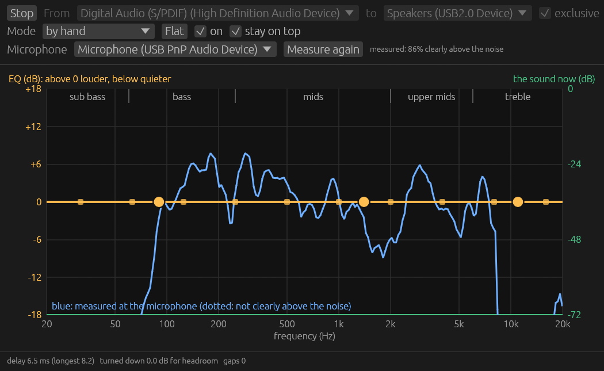
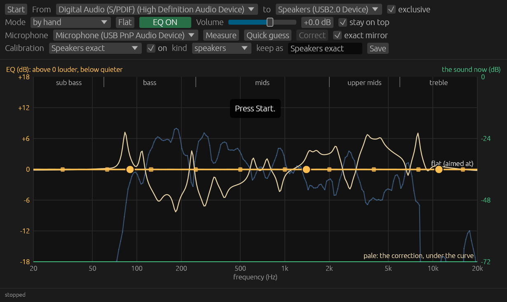

# Bottle EQ

Free, open-source speaker calibration and EQ for Windows and Linux. Make your speakers sound better for zero money.

## Features
- **Calibrate:** measure your speakers with a mic, Bottle EQ corrects them toward flat.
- **EQ:** shape the sound yourself, like a bass boost.
- **Compare:** toggle on/off to hear the difference.

## Mic tips
- Use a decent mic (a cheap USB mic is fine).
- Don't use webcam or laptop mics, they ruin the measurement.
- Put the mic where your head is.

Not a replacement for pro studio calibration gear.

## Build

```
cargo build --release        # Rust; on Linux first: sudo apt install libpipewire-0.3-dev libclang-dev pkg-config
target/release/bottle-eq     # the window (on Linux: bottle-eq window --to <speakers>)
```

MIT licence (`LICENSE`).

## The window


`bottle-eq` (or `bottle-eq window --from "S/PDIF" --to "Speakers"`) opens it (`src/window.rs`). It stays
on top of other windows. Choose where the sound is captured from and where it is played, and press Start.

One graph, from 20 Hz to 20 kHz on a logarithmic axis:

- **green: the live spectrum** of the sound the target is being given (so after the equalizer), its
  level in dB on the right-hand scale. 8192 samples at a time (171 ms, bins 5.9 Hz apart), Hann window;
  a level rises at once and falls 30 dB a second (`src/spectrum.rs`). What is drawn is the level of the
  sixth of an octave around each frequency (the bins' power there added up), so it is one smooth line:
  level for sound with as much power in every octave, as most music roughly has, and bent where the
  equalizer raises or lowers it;
- **amber: the equalizer's curve**, its gain in dB on the left-hand scale, with its handles:
  - the **small squares** are the ten bands: drag one up or down for that band's gain;
  - the **round points** are the free ones, as in FL Studio: drag one sideways for its frequency and up
    or down for its gain. The wheel over a point is its width. The right button on a point is its kind
    (a slope at the start or the end, a shelf, a peak, a spike) or takes it away; the right button or a
    double click on the empty graph makes a new point there (eight at most).

The sound changes while a handle is dragged: every move goes to the audio thread at once, which slides
to it without a click. **Mode** sets the ten bands; **Flat** puts every band at 0 dB and the points back
where they began (three of them at 0 dB): the sound then passes bit for bit as it came. The button **EQ ON /
BYPASSED** lets the sound pass untouched whatever curve and calibration are set, to hear the difference. The line at the bottom is the
delay, how far the sound is turned down for headroom, and the gaps so far.

**Volume** (the slider, or `--volume <dB>`) is a gain on the whole sound after the equalizer, from -30
to +18 dB. Above 0 dB it gives back what the headroom took (a correction that raises 6 dB somewhere
turns the whole sound down 6 dB first), and more. A sound at full height would then no longer fit, so a
limiter stands after it: the moment a frame would go over full scale the whole sound is turned down just
enough, at once, and let back up over a sixth of a second. Nothing clips; the loudest moments are held
back instead, and the bottom line says by how much. Checked: a quiet sine comes out 6 dB louder at +6;
a sine at full height at +12 never goes over full scale and stays a sine; back at 0 the sound passes
exactly as it came. In the running path, pink noise at full level with +12: captured loudest sample
1.098, handed to the target 1.0000, level up from -13.1 to -8.4 dB (the limiter took the rest).

Crates: `windows` (the audio), `rustfft` (the spectrum), `eframe`/egui (the window).

Checked:

- `cargo test`: the graph's places and frequencies agree both ways; the pointer takes the nearest handle
  within reach, a point before a band it lies on; a point dragged to 10 kHz and +8 dB is there and the
  curve is raised there; a slope follows the pointer only sideways; a sine stands in the spectrum at its
  frequency and level and falls 30 dB a second after it ends.
- In the running window (the picture above): Bach played to S/PDIF, a slope at 90 Hz, a dip, and a
  spike at 11 kHz that the window's own test (`--drag 3:12k:+9`: press, twelve moves, release, given to
  egui as pointer events) dragged to 12 kHz and +9 dB while the music played; the spectrum shows the
  slope and the spike in the sound. Delay 5.0 ms on average, 6.9 ms at the longest, no gap.

Its owner has used it and listened through it (2026-11-21). Not done: the devices chosen are not remembered
from one opening to the next. Run by double click, a console window opens beside it.

## The equalizer

Two layers make the curve (`src/eq.rs`), both run in the audio thread on each block just before it is
handed to the target:

- **Ten bands** at the octave centres 31.5, 63, 125, 250, 500, 1k, 2k, 4k, 8k and 16k Hz: the lowest a
  low shelf, the highest a high shelf, the eight between peaks one octave wide, each from -12 to +12 dB.
- **Points, as in FL Studio's parametric EQ**: up to eight filters put anywhere, each with a frequency, a
  gain, a width and a kind:
  - a **cut** makes the curve start (or end) with a slope: 12 dB an octave below a low cut. Its width is
    how sharp the corner is; a sharp one stands up as a ridge before the slope;
  - a **shelf** raises or lowers everything below (or above) the point;
  - a **peak** is a bump or a dip around the point; narrow, it is a spike.
  A point given no kind is a shelf if it is the lowest or the highest of several, else a peak.

They are RBJ's biquads in the shape of Vuuvee's `dsp/biquad.rs` (direct form I, 64-bit), one after
another.

- **Flat is exact.** A band or point at 0 dB is skipped, so with everything at 0 the sound leaves bit
  for bit as it came.
- **No clicks when the curve is set.** It is set from another thread through a few atomics; the audio
  thread moves each gain 0.25 dB and each frequency 6% a block (about 3 ms) toward what is set.
- **No clipping.** The whole sound is turned down by the highest point of the curve (headroom), so a
  raised curve cannot push a full-scale sound over. Raising part of it therefore makes the rest quieter.

### Modes

A mode is a named set of the ten bands' gains. There are 20 in `modes.txt`: Flat, Bass Boost, Deep
Bass, Bass Reducer, Treble Boost, Treble Reducer, Loudness, Classical, Rock, Pop, Jazz, Electronic,
Hip-Hop, Acoustic, Vocal, Speech, Movie, Gaming, Night, Small Speakers. They are starting shapes, not
measured for any speaker and not taken from any other program; the file is meant to be edited, and a
`modes.txt` in the folder Bottle EQ is run from is read instead of the one built in. A correction curve
for one pair of speakers is a line there like any other (the hook of step 3).

A mode sets the bands; the points stay as they are, on top of it. `flat` sets every band and point to
0 dB and takes the cuts away.

```
bottle-eq modes
bottle-eq run --from "S/PDIF" --to "Speakers" --mode rock
bottle-eq run --from "S/PDIF" --to "Speakers" --points "100:cut 1k:-2 12k:+8:spike"
bottle-eq curve --mode "bass boost" --points "100:cut:1.5 12k:+8:spike"      # the curve they make
bottle-eq run ... --gains 4,2,0,0,0,0,0,0,2,4                                # the ten bands by hand
```

A point is written `frequency:dB`, then optionally its width and its kind: `80:+5`, `1k:-3:2` (narrower),
`100:cut` (a slope at the start), `100:cut:1.5` (with a ridge), `12k:+8:spike`, `8k:+4:shelf`. Kinds:
`cut`, `shelf` (low or high by which side of 1 kHz), `lowcut`, `highcut`, `lowshelf`, `highshelf`, `peak`,
`spike`.

While `run` plays, a line sets the curve: `mode rock`, `modes`, `points 100:cut 12k:+8:spike`, `1k +3`
(one band), `flat`, `off`, `on`; an empty line stops. In the window of steps 4 and 5 the points are what
is dragged.

Measured:

- `cargo test`: 11 tests. Flat leaves the sound as it came (also with points standing at 0 dB); a band's
  peak is its gain at its centre, half of it half an octave away and nothing far away; the shelves raise
  the ends; points are shelves at the ends and peaks between, in whatever order they are given; a cut is
  -3 dB at its corner and 12 dB an octave below, a sharp one a ridge, a narrow peak a spike; a sine
  through bands and points together comes out at what the curve says within 0.05 dB at eleven
  frequencies; everything at +12 or -12 stays sound; the headroom keeps a full-scale sine at full scale;
  bands and points set, dragged and taken away while playing do not click; the 20 modes read and are
  found by name; flat takes the cuts away and keeps the points where they are.
- In the running path (`tools/eqcheck.py`: 20 s of pink noise played to S/PDIF, the spectrum of what the
  speakers were given over the spectrum of what was captured, against the curve, at 108 points from
  30 Hz to 18 kHz):

  | curve | mean difference | biggest |
  |---|---|---|
  | `--gains 6,0,-4,0,3,-6,0,4,0,-3` | 0.01 dB | 0.05 dB at 101 Hz |
  | `--mode "bass boost" --points "100:cut:1.5 1k:-2 12k:+8:spike"` | 0.03 dB | 0.37 dB at 11.5 kHz |

  (The 0.37 dB is on the flank of the narrow spike, where the measuring band, a twelfth of an octave, is
  wide against the curve's bend.) No gap, delay 5.9 ms on average and 8.1 ms at the longest.

Heard by its owner through the window (2026-11-21).

## Measure and calibrate

Three stages; all three are made. The third, the guesser, has not yet been tried in the room.

1. **Measurement** (done): what reaches the listening place is measured with a microphone.
2. **Correction** (done): the measured curve turned over into the equalizer's curve, kept as named
   calibrations.
3. **Guesser** (made; tried on 147 headphones it did not learn from, not yet in the room): a whole
   correction guessed from a short, noisy sample and the kind of device.

### Stage 1: measuring



In the window: choose the microphone, put it where you listen, press **Measure**. A sine rises from
20 Hz to 20 kHz in ten seconds out of the speakers (loud) while the microphone records, and then once
more 10 dB quieter: about half a minute in all. The blue line is what reached the microphone, on the
curve's own scale, against its own average between 200 Hz and 5 kHz. Where a frequency is not to be
believed the line is dotted: where it is not at least 10 dB above the room's noise, or where it did not
come out 10 dB quieter (within 3 dB) in the quieter sweep. Speakers and a room answer the same at any
level; what does not is not theirs alone, and no equalizer sets it right. Measure again at any time;
the line is the last one.
From the keyboard: `bottle-eq measure --mic <microphone> --to <speakers> [--from <source>] [--keep file.csv]`.

While the path runs the sweep is played to its source, so it passes the equalizer as music does: the
line is then what the seat gets with the curve that is set. Stopped, it goes straight to the speakers.

How (`src/measure.rs`): the recording's spectrum over the sweep's is what the way from the program to
the microphone did to each frequency; turned back into time it is a spike where the sound arrives and
the room's echoes after it. Nothing is lined up by hand: where the spike stands is the delay. The ten
seconds of sweep are gathered into that spike while the noise stays spread over the whole time, and
only the half second around the spike is kept; what noise remains is read with the same window after
the spike, where only noise is.

**The microphone is in the curve.** What is measured is speakers, room and microphone together; a
cheap microphone's weak bass or treble cannot be told from the speakers'.

Measured (2026-11-21):

- `cargo test`: a way that changes nothing measures flat within 0.2 dB from 25 Hz to 18 kHz (at 48,000
  and 44,100 Hz); the equalizer's ten bands are measured through noise within 0.5 dB; a small speaker in
  a noisy room has its bass marked uncertain and the rest right; a recording without the sweep says so.
- On Linux, with a microphone that hears exactly what the speakers are given (`linux/test.sh`): flat
  measures flat within 0.11 dB, and ten bands set are measured as set: mean difference 0.01 dB, biggest
  0.06 dB.
- In the room, the USB speakers and a USB microphone (`Microphone (USB PnP Audio Device)`):
  - 86% of the frequencies are clearly above the noise. Nothing arrives below about 60 Hz, and above
    9 kHz it falls away by 25 dB and more (speakers or microphone: it cannot be told which);
  - the same measurement twice (frequencies from 62 Hz to 8.9 kHz that are 25 dB above the noise):
    mean difference 0.28 dB, biggest 3.5 dB at 8.6 kHz, where the curve falls steeply;
  - straight to the speakers against through the path, flat: mean difference 0.31 dB;
  - ten bands set (`6,0,-4,0,3,-6,0,4,0,-3`) against flat, less the curve set: from 500 Hz to 4 kHz the
    measured change is the curve within 0.05 dB (at 494 Hz +1.76 for +1.76, at 987 Hz -5.22 for -5.28,
    at 3948 Hz +3.74 for +3.77); at 247 Hz +0.34 for -0.44, at 123 Hz -4.61 for -3.89, at 64 Hz -5.66
    for -0.40;
  - **below about 100 Hz these two devices do not answer the same at another level**: with the sweep
    10 dB quieter the level at 80 Hz is 7 dB lower again and at 64 Hz 24 dB lower again (from 100 Hz up:
    within about 1 dB). So down there the line is not one curve that an equalizer could turn over, and
    being above the noise does not show it.

    The second, quieter sweep was added for this: such frequencies are now marked as not to be believed
    (with it, 73% of the frequencies are believed, against 86% by the noise alone).

Not done: nobody but the program's own test has pressed Measure in the window.

### Stage 2: correcting



**Correct** turns the last measurement over into a correction (`src/calibrate.rs`), so that what reaches
the microphone becomes flat. In the picture (the calibration "Speakers exact"): the faint blue line is
what was measured, the pale curve the correction, its mirror image, and the amber line at 0 dB the
curve set by hand, on top of the correction and here flat. Measured again through the correction, a
bright blue line shows how near flat it came.

- **What is set right** is the speakers and the room alone: the measurement less the equalizer's curve
  the sweep went through. So it can be corrected again from any later measurement.
- **What is wanted** is that turned over, read a third of an octave wide (a narrow dip is a place in the
  room; a hand's width away it is elsewhere). Nothing is raised more than 6 dB (a deep hole is sound
  that cancels itself: more of it cancels as much), nothing lowered more than 12.
- **Nothing is done** where the measurement is not to be believed, nor past the ends of what the
  speakers can do (where the level lies more than 10 dB under the rest); toward those ends what is
  wanted fades out over a third of an octave, so a falling edge is not propped up.
- **The curve** is made of what the equalizer has: the ten bands' gains, then points (up to eight) put
  where the most is still missing, each number tried in turn until the curve lies on what is wanted. It
  takes half a second.

**Two ways of turning the curve over.** What is described above is the careful way (`--gentle`, or
"exact mirror" unticked in the window). The other, which is what Correct does unless told otherwise, is
the **exact mirror**: the mirror image of the measured curve as it was measured (a sixth of an octave
wide), raised as much as 12 dB, not faded toward the ends, made of as many as 24 points (the equalizer
holds 24 since this; it held 8). It is flattest at the place that was measured; it asks more of the
speakers, takes more headroom (turn the volume up), and a step to the side the narrow things it set
right are elsewhere. On the measurement kept from the room (nothing played): the exact mirror's curve
lies 0.45 dB from what is wanted and would bring 4.11 dB from flat to 0.62 dB, the careful way 3.97 dB
to 1.90 dB, *if the speakers do as the curve says*. Making it takes about three seconds.

Measured in the room (2026-11-21; measured, corrected with the exact mirror, measured again through
it): within reach 160 frequencies from 82 Hz to 8.1 kHz; the curve lies 0.46 dB from what is wanted
(2.57 dB at the most); **from flat: 3.88 dB before, 0.95 dB after** (the careful way: 3.90 to 1.76).
It took 7.3 dB of headroom. Kept as the calibration "Speakers exact". Not yet listened to.

**The correction lies under the curve.** It is a curve of its own in the equalizer (ten bands and up to
24 points, like the one set by hand), run before it. A mode, the bands and the points are put on top of
it and leave it as it is, and so does Flat; choosing another calibration (or "none") changes it, and the
tick beside the list leaves it out for a moment, to hear what it does. In the window it is the thin pale
line; from the keyboard `--calibration <name>`, and while `run` plays `calibration <name>` and
`calibration none`. (Before this a mode set the same ten bands a calibration had set, and half the
correction was gone.) A measurement takes off all that the sweep went through, the correction and the
curve on top alike, so Correct can be pressed with a mode on. Checked: at six frequencies the sound
through a correction with a mode on it comes out at what the two curves say together, within 0.05 dB;
flat takes the mode away and leaves the correction; in the running path (pink noise, the calibration
"Speakers exact" with the mode Rock on it) the sound is what the two say together: mean difference
0.09 dB, biggest 0.81 dB at 80 Hz, on the flank of the correction's narrowest peak.

**Save** keeps the correction under a name ("Speakers", "Headphones") with the devices, the day and the
measurement it was made from: a file in the folder `calibrations` where Bottle EQ is run from. The list
beside it sets one that was kept; so does `--calibration <name>` for `run` and the window.

```
bottle-eq measure --mic <mic> --from <source> --to <speakers> --correct --save Speakers
bottle-eq calibrations
bottle-eq run --from <source> --to <speakers> --calibration speakers
bottle-eq correct --keep measurement.csv      # the correction a kept measurement asks for (nothing is played)
```

Measured (2026-11-21):

- `cargo test`: speakers with a hump in the bass, a dip in the middle and a falling treble come out
  flat within 0.6 dB (from over 2.5 dB); nothing is done where the measurement is not believed, a hole
  20 dB deep is raised by 6 dB at the most, and speakers with nothing above 9 kHz are left alone there;
  the equalizer the sweep went through is taken off; a calibration is read back as it was written.
- On Linux (`linux/test.sh`, the microphone that hears exactly what the speakers are given): the way is
  flat there, and measured through ten bands set to anything the correction comes out as nothing (every
  band within 0.2 dB of 0, no point): the equalizer the sweep went through is taken off.
- In the room (the USB speakers, the USB microphone, through the path): measured, corrected, measured
  again. Within reach were 157 frequencies from 85 Hz to 7.7 kHz. The correction: bands
  `-0.2 +0.5 -1.5 -3.0 -2.4 -0.6 +5.7 -1.0 -0.2 0` and eight points; the curve lies 0.57 dB from what
  was wanted (1.41 dB at the most). **From flat: 3.90 dB before, 1.76 dB after** (the usual distance of
  the level from its mean, over the 155 frequencies within reach and believed both times). Done again
  from the window: 4.0 dB before, 1.8 dB after.
  What is left is mostly what was not asked for: the narrow dips and peaks inside a third of an
  octave, and the dip at 1.6 to 2 kHz, which is deeper than the 6 dB it may be raised by.

Listened to by its owner (2026-11-21, the calibration "Speakers" against the equalizer off, music
through the window): "the sound is clean and the change is massive". Not done: only these speakers and this microphone were tried, at one place
in the room; headphones cannot be measured this way (a microphone in the room does not hear what an ear
inside them does). The microphone's own response is turned over along with the speakers'.

### Stage 3: the guesser

A short measurement (one sweep, a quarter of a minute, perhaps in a noisy room) is believed at some
frequencies and not at others. The guesser (`src/guess.rs`) fills in the others from what curves of the
same kind of device look like, and the correction is made from the whole curve at once.

- **What it learns from**: curves kept in `training/<kind>/`, brought in with
  `bottle-eq import <file or folder> --type <kind>` (AutoEq's result files, of which the column "error"
  is taken: how far from its target the device is; or any table of frequency and dB), and the
  measurements of the calibrations kept for that kind, at the frequencies that were measured and
  believed there. The kinds are `speakers` and `headphones`.
- **What it learns**: the kind's average curve, the (up to eight) ways its curves most differ from the
  average, and how hard a guess should be held to the average: some of the kind's own curves are hidden
  in part and guessed with each of a row of holds, and the best is kept.
- **How it guesses**: the average, moved up or down as a whole and along those ways as far as the
  measured frequencies ask for, held back toward the average. So that it meets what was measured
  without a step, what the measured part still differs by at its edge is carried on into the guessed
  part and fades to half every half octave.
- **What is guessed is said**: in the window in violet dashes, apart from the blue that was measured; in
  the table from the keyboard by the word. A calibration saved from a guess keeps only what was measured
  as measured, so the guesser never learns from its own guesses.
- A frequency at which no curve of the kind was ever believed is guessed even if one sweep hears it
  above the noise: one sweep cannot tell what changes with the level (small speakers' lowest bass).

In the window: **Quick guess** (one sweep, the correction set at once), then **Measure again** (the whole
measurement, through the correction) to see how near flat it came, and **Correct** to do it over from
that. From the keyboard:

```
bottle-eq import <AutoEq's results folder> --type headphones
bottle-eq training --test                  # what there is to learn from, and how well it guesses
bottle-eq guess --mic <mic> --from <source> --to <speakers> [--type speakers] [--save <name>]
bottle-eq guess --type headphones --like "WH-1000XM4" --save "WH-1000XM4"   # by name, nothing measured
```

The last is for what cannot be measured here at all: headphones (a microphone in the room does not
hear what an ear inside them does). The curve of that model from the training set is taken as it is;
the correction then aims at the target its measurer used (for AutoEq's files a Harman curve), not at
flat, and holds only as far as this pair is like the one that was measured.

Measured (2026-11-21):

- `cargo test`: a table is read (AutoEq's kind and a plain one) and set onto the frequencies kept; of a
  made-up kind of device (three shapes of chance size), curves held out and shown only from 300 Hz to
  2 kHz are guessed much nearer than the kind's average does; what was measured stays as it was and the
  guess meets it without a step; with nothing to learn from, the measured part's level is carried on.
- On real curves: the 736 headphones of one measurer (oratory1990) from AutoEq's results, brought in
  with `import`. Every fifth by name was held out (147), the other 589 learned from; of each held-out
  curve only a part was shown. The usual error (dB) over the frequencies not shown:

  | shown | the guess | the kind's average alone | a level line |
  |---|---|---|---|
  | 300 Hz to 3 kHz | 4.37 | 4.47 | 4.93 |
  | 100 Hz to 8 kHz | 4.18 | 4.75 | 5.43 |
  | 500 Hz to 20 kHz | 4.07 | 4.17 | 4.69 |
  | 20 Hz to 2 kHz | 4.19 | 4.34 | 4.71 |

  **The guess is nearer than the average, by little** (2 to 12 percent): most of what makes one pair of
  headphones differ from another outside the part shown is its own, and is not to be had from the part
  shown. A wrong turn on the way: followed closely (hold 1), the guess was *worse* than the average
  alone (5.2 to 8.1 dB); the hold now learned for this kind is 30.
- `guess --type headphones --like "WH-1000XM4"`: the correction lies 0.32 dB from what is wanted (1.27 dB
  at the most); off its target within reach 3.20 dB as its measurer found it, 0.84 dB with the
  correction *if this pair is as that one was*. Kept as the calibration "WH-1000XM4". Not listened to.

Not done: the guesser has not been tried in the room (a quick guess, then a whole measurement to see how
near flat it came). For speakers there is one curve to learn from, the calibration "Speakers" itself:
a guess for these speakers at this place is then little more than that calibration again, and says
nothing of other speakers. The training curves are not in this repository (they are their measurers').

## On Linux

The equalizer, the modes, the spectrum and the window are the same code on both systems; only the
sound's way in and out differs (`src/audio.rs`: `audio/wasapi.rs` on Windows, `audio/pipewire.rs` on
Linux, which needs PipeWire, as current distributions have).

PipeWire is one graph in which every program that plays and every device is a node, all run in the same
cycle. So nothing is listened to from the side as on Windows: Bottle EQ puts **a device of its own,
"Bottle EQ"**, into the graph and plays what arrives there, equalized, on to the speakers within the
same cycle. There is no spare device to go round by, no second clock, no cushion and no exclusive mode.

```
sudo apt install libpipewire-0.3-dev libclang-dev pkg-config     # to build (Ubuntu's names)
cargo build --release
bottle-eq devices                 # 1 is Bottle EQ's own device, the others are the speakers
bottle-eq window --to <speakers>  # starts at once; then choose "Bottle EQ" as the output device in the sound settings
bottle-eq run --to <speakers> --mode rock
```

Bottle EQ asks the graph for blocks of 1024 frames (21 ms), PipeWire's usual. On the first real machine
it was tried on (2026-11-21), the 128 frames (2.7 ms) asked for until then broke the sound up, and a
measurement made through that came out wrong; whether 1024 mends it there has not yet been heard.
Where the sound card keeps up, less can be asked for: `BOTTLE_EQ_BLOCK=128 bottle-eq window ...`.

On that machine the sound did not break up after all, as its owner then heard; what he heard was the
second sweep of a measurement, sent 10 dB quieter than the first, come out much *louder*. Something
there sets the volume by itself (what, is not known), so nearly every frequency was marked as not to be
believed. Since then each frequency of the quieter sweep is held against how that sweep arrived as a
whole, not against the 10 dB it was sent at, and when the whole is more than 3 dB from those 10 dB the
measurement says so. Not yet tried on that machine.

Checked (2026-11-21) in a box without a sound card (`linux/Dockerfile`, `linux/test.sh`: Ubuntu 24.04,
PipeWire 1.0.5 and WirePlumber, one output device that plays to nowhere):

- `cargo test`: 17 tests (the 15 of Windows and two of the PipeWire part).
- `selftest`: the 1 kHz tone comes through whole (100% of the sound is 1 kHz, no jump beyond the tone's
  own, nothing dropped, never dry).
- Flat: 20 s of pink noise leave **bit for bit** as they came (1,034,496 frames compared).
- The equalizer in the running path, as on Windows (`tools/eqcheck.py`, same noise, same curves):

  | curve | mean difference | biggest |
  |---|---|---|
  | `--gains 6,0,-4,0,3,-6,0,4,0,-3` | 0.01 dB | 0.05 dB at 101 Hz |
  | `--mode "bass boost" --points "100:cut:1.5 1k:-2 12k:+8:spike"` | 0.03 dB | 0.37 dB at 11.5 kHz |

- The window (under Xvfb, software OpenGL): it opens, shows the live spectrum of music played to
  "Bottle EQ", and its own test drags a point (`docs/window-linux.png`).

Not done on Linux: on a real machine with a sound card it has been tried once (see above: the sound
broke up), the delay is not measured (the box's device says 0 ms; what is shown is what PipeWire says of
the way to the device, as for any program), and programs that speak PulseAudio (browsers; through
pipewire-pulse) have not been tried, only PipeWire's own.

## How the sound gets through (WASAPI loopback)

Windows mixes every program's sound for one output device (an endpoint: the speakers, S/PDIF) into one
stream, one block ("period") at a time: 10 ms unless someone asks for less. Loopback is a capture
stream opened on an *output* endpoint: Windows hands over a copy of the finished mix on its way to that
device. Five things follow:

1. **It is a copy.** The device still plays the original, so Bottle EQ captures from one endpoint, the
   **source** (the one Windows plays to, which you do not hear), and plays the processed sound to
   another, the **target** (the one you listen to). On this machine the source is S/PDIF (nothing is
   plugged into it) and the target is the USB speakers.
2. **Silence is no data.** When nothing plays, loopback delivers nothing; playback then plays silence.
3. **Two devices, two clocks.** Their 48,000 Hz differ by some tens of parts per million. The ring
   between capture and playback is read a hair fast or slow (at most 0.1%, under 2 cents of pitch) so
   that its fill stays at the cushion, and the lasting difference is learned.
4. **The delay is made of blocks.** A sound waits for the source's block to end, then in the ring, then
   for the target's buffer. With 10 ms blocks on both sides that was 44 ms. So the source's engine is
   asked for its least block (IAudioClient3: 2.67 ms on S/PDIF; a silent stream at that period is
   enough), and the target is opened in **exclusive mode** at its least block (3 ms): Bottle EQ then
   owns the speakers and nothing else can play to them while it runs. `run` asks before taking them
   (`--exclusive` and `--shared` answer in advance).
5. **Exclusive mode cannot be listened to by loopback**, so the delay is measured on the clock: from a
   block arriving from the source's engine to its frames beginning to play at the target.

In exclusive mode the path is one thread (`direct` in `src/wasapi.rs`): wait for a block from the
source, read it at the target's rate, process it, write it into the target's buffer. In shared mode it
is capture thread -> lock-free ring -> playback thread. The audio threads have Windows' "Pro Audio"
priority, wake on the device's own event, and never lock or allocate. All of it is on WASAPI directly,
through the `windows` crate.

## Use

```
bottle-eq                                          the window (on Linux: bottle-eq window --to <speakers>)
bottle-eq devices                                  the output devices, their formats and blocks, and the microphones
bottle-eq measure --mic <mic> --to <device>        a sweep out of the speakers, recorded by the microphone
bottle-eq guess --mic <mic> --to <device>          one short sweep, the rest guessed, the correction set
bottle-eq run --from <device> --to <device>        capture what plays to one, play it to the other (Enter stops)
bottle-eq selftest --from <device> --to <device>   a quiet 1 kHz tone through the whole path, measured
```

A device is its number in `devices` or a part of its name. `--cushion-ms <n>` is the sound kept in the
target's buffer on top of what the two devices' blocks need (default 2). To use it: make the source the Windows
default output device, then `run`.

## Measured (2026-11-20, this machine)

`selftest` plays a 1 kHz tone at -40 dB to S/PDIF like any program would, and looks at what is captured
and at what is handed to the target: how much of it is the tone, the loudest jump between two frames (a
click shows there), whether the device ran out of sound, and the delay Bottle EQ adds (from a block
arriving from the source's engine to its beginning to play).

To the USB speakers, exclusive mode, 16-bit, periods of 144 frames (3 ms):

| path | cushion | tone | delay, mean | longest | ran out | clean |
|---|---|---|---|---|---|---|
| cpal, shared mode (the first version) | 25 ms | 1.5 s | 44 ms | | 0 | yes |
| two threads and a ring | 3 ms | 20 s | 11.9 ms | 17.6 ms | 0 | yes |
| two threads and a ring | 1 ms | 60 s | 8.2 ms | 15.7 ms | 16 | no: clicks |
| **direct** | 3 ms | 5 s | 9.1 ms | 11.4 ms | 0 | yes |
| **direct** | 2 ms (default) | 30 s | 6.0 ms | 12.7 ms | 0 | yes |
| **direct** | 1 ms | 30 s | 4.8 ms | 9.7 ms | 0 | yes |
| **direct** | 1 ms | 60 s | 4.6 ms | 9.9 ms | 0 | yes |
| **direct** | 1 ms | 20 s, three runs | | | 0 | yes |

The direct path (the default in exclusive mode): one thread; each block is read at the target's rate,
processed and written into the target's buffer as it arrives from the source, behind what is already
queued. With two threads the ring had to hold a whole block of the target's before every read, because
the two threads woke on two unrelated clocks; that block is what was saved. The longest delays are from
the first seconds, while the two clocks' difference is still being learned. Shared mode still goes
through the ring and two threads.

Not explained: in 2 runs of 10 the *captured* sound itself had one jump (0.00792 both times, where the
tone alone moves 0.0013 a frame), with no break reported by Windows; the path passed it on as it came.
It is either this test's tone or the source's engine at its short period. `selftest` says so when it
sees it.

### With music

`playtest` plays a WAV file to the source and keeps what was captured and what the target was given:

```
bottle-eq playtest --from "S/PDIF" --to "Speakers" --exclusive --file test/music.wav --level 0.1 --record test/out
python tools/compare.py test/music.wav test/out/captured.wav 0.1    # wave against wave
python tools/spectra.py test/out/captured.wav test/out/handed.wav   # band against band
```

40 s of Bach's Toccata and Fugue in D minor, BWV 565 (a public-domain recording from Wikimedia Commons,
`Toccata_et_Fugue_BWV565.ogg`, performed by Ashtar Moïra), played 20 dB down:

- No gap anywhere: ran out 0 times, 0 dropped, 0 late, 0 breaks. Delay 5.3 ms on average after the first
  3 s, 10.4 ms at the longest (the queue at its fullest and a whole period's wait at once).
- **Played -> captured** (the source side): the same sound, wave for wave (alike 1.00000 in every 43 ms
  window but the first, where the comparison had not yet found its place), 0.78 dB lower: the S/PDIF
  device's own volume setting, most likely.
- **Captured -> given to the speakers** (Bottle EQ itself, with nothing switched on: there is no
  equalizer yet, so flat is what it should be), level by octave band over the whole piece:

  | band (Hz) | 31.5 | 63 | 125 | 250 | 500 | 1k | 2k | 4k | 8k | 16k |
  |---|---|---|---|---|---|---|---|---|---|---|
  | 4-point read (first) | 0.00 | 0.00 | 0.00 | 0.00 | 0.00 | 0.00 | 0.00 | -0.01 | -0.12 | -0.78 |
  | windowed sinc (now) | 0.00 | 0.00 | 0.00 | 0.00 | 0.00 | 0.00 | 0.00 | 0.00 | 0.00 | +0.01 |

  And through the piece, in stretches of 5 s: the 16 kHz band was -0.68 to -0.90 dB with the 4-point
  read (and from one 85 ms window to the next anything from +0.06 to -2.06 dB, as the two clocks slid
  past each other); with the sinc it is 0.00 to +0.03 dB in every stretch. Window by window (937) the
  biggest difference in any band is 0.04 dB in the median (was 0.53), 1 window differs by more than
  3 dB (at 0.73 s, where the two files are least well lined up), none by 6 dB: no click or gap shows.
- The sinc reads 16 frames behind the newest sound (0.33 ms), which is counted in the delay: 5.8 ms on
  average, 9.9 ms at the longest, for this piece.
- The one window that differed by more than 3 dB (0.725 to 0.811 s) holds the very first note of the
  piece (0.788 s). Lined up on its own it differs by 0.00 to 0.01 dB in every band: it was 163 frames
  off the place the whole file was lined up to, because the delay was 3.4 ms longer at the start than
  later (the device takes a few milliseconds to begin taking sound, and what was written meanwhile
  stayed queued until 20 s of reading fast had used it up). For the first half second a block that
  would put the queue over the cushion is now not written; the longest delay in the next run was
  8.1 ms.

Not done: nobody has listened yet, and what the speakers themselves made of it was not recorded (there
are microphones on this machine; they were not used). `test/out/handed.wav` is what the speakers were
given, to listen to.

What the devices allow (`cargo run --release --example periods`): S/PDIF shared blocks down to 2.67 ms;
the USB speakers 10 ms shared, 3 ms exclusive. The monitor's output has no speakers.

Wrong turns, for the record: the time stamp WASAPI gives with a loopback block is not the moment it was
mixed (measured against it the delay came out as 4 ms); the ring kept what had gathered while the
target was being opened (14 ms); the test's own tone was cut mid-wave at its end and read as a click; a
counter that hid one "ran dry" hid sixteen.

From the toolkit: Vuuvee (`Desktop/Projektit/Vuuvee`) has its own biquad, EQ, matching EQ, FFT,
resampler and declicker (`src/dsp/`) for steps 2 to 4, and a live path on cpal at about 30 ms.
StrikeUFP pins threads to cores (`gpu/src/remote/win.rs`).
